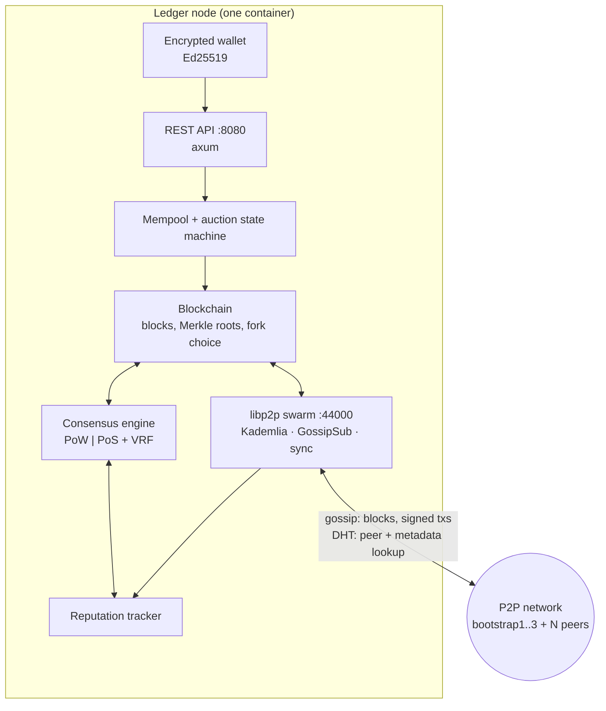

# Distributed Auction Ledger

A permissionless, containerised blockchain for **English auctions**, written from scratch in Rust.
Every node is a full participant: it discovers peers over a Kademlia DHT, gossips signed
transactions and blocks, validates and seals blocks under a pluggable consensus engine
(Proof-of-Work **or** VRF-based Proof-of-Stake), and serves a REST API for the auction application.

Built for the *Segurança em Sistemas Distribuídos* (Distributed Systems Security) course of an
MSc in Information Security — the brief asked for a genuinely distributed, adversary-aware
prototype, not a simulation inside a single process.

```
docker compose up --build --scale peer=10   →   13-node network, auctions settling on-chain
```

---

## Table of contents

- [Highlights](#highlights)
- [Architecture](#architecture)
- [Quick start](#quick-start)
- [Configuration](#configuration)
- [REST API](#rest-api)
- [Transaction model](#transaction-model)
- [Consensus](#consensus)
- [Security model](#security-model)
- [Known limitations](#known-limitations)
- [Demo scenarios](#demo-scenarios)
- [Repository layout](#repository-layout)
- [Tech stack](#tech-stack)
- [Authors](#authors)

---

## Highlights

| | |
|---|---|
| **Real P2P overlay** | libp2p: Kademlia DHT for discovery and off-chain storage, GossipSub for block/transaction flooding, Noise-encrypted transports, a custom `/ledger/sync/1.0.0` request–response protocol for chain catch-up |
| **Two consensus engines** | Proof-of-Work (leading-zero difficulty target) and Proof-of-Stake with a **VRF** (Schnorrkel) leader election weighted by peer reputation — swappable with one environment variable |
| **Authenticated transactions** | Ed25519 signatures, `sender_id = SHA-256(pubkey)[0..16]`, per-sender nonces for replay protection, mempool deduplication |
| **Adversary-aware P2P** | Reputation tracker with automatic banning of peers that broadcast invalid blocks, persisted across restarts; banned peers cannot mine or influence PoS leader election |
| **Fork resolution** | Longest-valid-chain rule with full re-validation of every incoming chain (links, Merkle roots, consensus proof, and replay of all auction state transitions) |
| **Finality semantics** | Confirmation-depth based finality exposed per block and per transaction over HTTP |
| **Observability** | `/metrics` endpoint: TPS, blocks mined, mempool size, connected peers, block rejection rate, average block time |
| **Reproducible experiments** | A dozen Python/shell scenarios driving fault injection, node churn, attack recovery and mining races against a live network |

## Architecture

Each container runs one node — there is no privileged coordinator. Bootstrap nodes only differ
in having a stable address inside the Compose network.



**Request path of a bid.** A client signs an `AuctionCommand` with its Ed25519 key and POSTs it to
any node's `/command/signed`. The node verifies the signature, checks the sender nonce, applies the
auction state-machine rules (auction open, bid strictly higher than the current best), admits it to
the mempool and gossips it. A miner seals the mempool into a block, broadcasts it, and every peer
independently re-validates the block before appending. Nodes that fall behind detect the height gap
and pull the missing blocks over the sync protocol.

## Quick start

**Requirements:** Docker with Compose v2. (For local builds: Rust 1.75+.)

```bash
git clone https://github.com/afarturc/distributed-auction-ledger.git
cd distributed-auction-ledger

cp .env.example .env          # set LEDGER_WALLET_PASSWORD, pick the consensus mode
docker compose up --build --scale peer=10 --remove-orphans
```

This starts 3 bootstrap nodes and 10 peers on a user-defined bridge network, each with its own
persistent volume for ledger data and node identity. Give the DHT ~15 seconds to converge.

```bash
docker compose ps                                  # inspect
curl -s localhost:8080/status | jq                 # chain height + session metrics
curl -s localhost:8080/auctions | jq               # auction book
docker compose down -v                             # teardown, including volumes
```

Drive a full auction round (20+ write operations interleaved with reads):

```bash
python3 scripts/demo.py
```

Mine manually (when `AUTO_MINE=false`):

```bash
curl -X POST localhost:8080/admin/mine
# or attach to a node and type /mine
docker attach ledger_bootstrap_1      # detach with Ctrl+P, Ctrl+Q
```

Run without Docker (single node):

```bash
cargo run                             # add bootstrap multiaddrs as arguments to join a network
cargo test
```

## Configuration

All services read the same `.env` (see [`.env.example`](.env.example)):

| Variable | Default | Purpose |
|---|---|---|
| `LEDGER_WALLET_PASSWORD` | — (**required**) | Passphrase encrypting the node wallet at rest (`~/.ledger/keys.enc`) |
| `CONSENSUS_MODE` | `POW` | `POW` or `POS` |
| `AUTO_MINE` | `false` | Autonomous interval mining vs. manual `/mine` |
| `BLOCK_TIME_SECS` | `10` | Target block interval when `AUTO_MINE=true` |
| `NODE_WORKDIR` | `/data` | State directory inside the container (Docker volume) |

Ports: only `8080` (REST) and `44000` (P2P) are published, and only for the bootstrap nodes plus a
host port range for scaled peers. Internal traffic uses Compose DNS on `ledger_net`.

## REST API

| Method | Endpoint | Description |
|---|---|---|
| `GET` | `/status` | Chain height and session metrics |
| `GET` | `/ledger` | Full chain (also used for bootstrap catch-up) |
| `GET` | `/auctions` | All known auctions and their state |
| `GET` | `/auction/:id` | A single auction |
| `GET` | `/metrics` | TPS, blocks mined, mempool size, peers, rejection rate, avg block time |
| `GET` | `/finality/block/:index` | Confirmations and finality for a block |
| `GET` | `/finality/tx/:block/:tx` | Confirmations and finality for a transaction |
| `POST` | `/command/signed` | Submit an Ed25519-signed auction transaction |
| `POST` | `/command` | Submit an unsigned command (development only) |
| `POST` | `/command/rich` | Create an auction with metadata stored off-chain in the DHT |
| `POST` | `/dht/put`, `GET /dht/val/:key` | Direct Kademlia put/get |
| `POST` | `/admin/mine` | Trigger a mining round |
| `POST` | `/admin/inject_invalid_block` | Adversarial testing: broadcast a deliberately invalid block |

## Transaction model

Auctions are an explicit state machine — `Pending → Open → Closed` — replayed deterministically
from the chain by every node:

| Command | Rules enforced on every node |
|---|---|
| `CreateAuction` | Auction id must be unused; creator recorded from the verified signature |
| `StartAuction` | Only from `Pending` |
| `PlaceBid` | Auction must be `Open`; amount strictly greater than the current best (or the starting price); nonce must be unseen |
| `CloseAuction` | Only the authenticated `creator_id` may close the auction |

```jsonc
POST /command/signed
{
  "sender_id":  "9f2c…",              // SHA-256(public_key)[0..16], hex
  "public_key": [ /* 32 bytes */ ],
  "command":    { "PlaceBid": { "auction_id": "a1", "bid_amount": 150,
                                "bidder_id": "9f2c…", "nonce": 7 } },
  "signature":  [ /* 64 bytes, Ed25519 over the serialised command */ ]
}
```

Block validation is atomic: a block is applied to a scratch copy of the auction state first, and is
rejected outright if any transaction in it is invalid — so a single bad transaction can never
partially mutate a node's state.

## Consensus

Both engines implement the same `ConsensusEngine` trait (`seal_block` / `validate_block`), so the
chain, mempool and P2P layers are agnostic to which one is loaded.

- **Proof-of-Work** — SHA-256 with a leading-zero difficulty target. Mining runs *outside* the chain
  lock and is cancelled via `tokio::select!` the moment a competing block arrives at the same height,
  which is what keeps a 13-node network from forking on every round.
- **Proof-of-Stake with VRF** — each node evaluates a Schnorrkel VRF over the previous block hash;
  the output is compared against a threshold weighted by the node's reputation score. The proof
  travels in the block, so any peer can verify the leader was entitled to produce it, without
  trusting the producer. Fresh peers start at maximum reputation to avoid a cold-start deadlock.

Fork choice is longest-*valid*-chain: an incoming chain is only adopted after every link, Merkle
root, consensus proof and auction transition in it has been re-verified locally.

## Security model

The prototype was graded on its security properties; these are the controls it implements.

| Threat | Control |
|---|---|
| Forged or tampered transactions | Ed25519 signatures verified at ingestion and again during block validation; `sender_id` bound to the public key by hash |
| Replay of a valid transaction | Per-sender nonces plus mempool deduplication by command hash |
| Block tampering | Merkle root over transactions, hash-linked blocks, full recomputation on receipt |
| Malicious block producers | Reputation tracker scores every submission; peers below the ban threshold are barred from mining and from PoS leader election, and the state survives restarts |
| Sybil / Eclipse patterns | Kademlia routing hygiene plus multiple independent bootstrap nodes; gossip messages are signed (`ValidationMode::Strict`) so identities cannot be spoofed |
| Non-responsive or slow peers | Bounded request timeouts on the sync protocol, liveness probes via `ping`, retries capped |
| Key exposure | Node identities live on Docker volumes, never in the image or the repository; the wallet is loaded under a passphrase supplied through the environment (see [Known limitations](#known-limitations)) |
| Excessive exposure | Only the auction API and the P2P listener are published to the host; everything else stays on the internal Compose network |

Unsigned `/command` and `/admin/*` exist for demonstration and adversarial testing, and would be
removed or authenticated in a production deployment.

## Known limitations

Deliberately documented rather than hidden — this is a course prototype, and these are the gaps a
security review of it should surface:

- **The wallet is not actually encrypted.** `LEDGER_WALLET_PASSWORD` is required and threaded
  through the wallet API, but `save_to_disk` currently serialises the keypair as plain JSON to
  `~/.ledger/keys.enc`. Closing this means a real KDF (Argon2) plus authenticated encryption
  (AES-GCM / XChaCha20-Poly1305) behind the existing interface.
- **The PoS VRF key is derived from the public peer id** (`SHA-256(miner_id)`), so any peer can
  recompute another peer's VRF secret and forge its leader-election proof. The VRF plumbing —
  proof in the block, verification on receipt, reputation-weighted threshold — is real; the key
  material is not. It should be bound to the node's private identity key instead.
- **Reputation is per-node local state**, not consensus state, so two nodes can disagree about who
  is banned. Sybil resistance therefore rests on PoW cost (or, under PoS, on honest bootstrap
  peers) rather than on reputation alone.
- `POST /command` accepts unsigned commands and `/admin/*` is unauthenticated; both are kept for
  the demo and fault-injection scripts.

## Demo scenarios

[`docs/DEMO.md`](docs/DEMO.md) is a full validation run — 13 steps from a cold network to teardown.
The scripts in [`scripts/`](scripts/) are the executable parts:

| Script | What it demonstrates |
|---|---|
| `demo.py` / `demo2.py` | End-to-end auction lifecycle: create, start, bid, close, with reads interleaved |
| `demo_simultaneous_mining.py` | Two nodes sealing the same height — race handling and fork resolution |
| `demo_recovery.py` | Node churn: kill nodes, restart them, watch them catch up from the network |
| `demo_attack_recovery.py` | Recovery after a malicious peer floods invalid blocks |
| `demo_reputation_ban.py` / `demo_peer_ban_usage_attempt.py` | Reputation decay, banning, and a banned peer's attempt to keep mining |
| `demo_vrf_pos.py` | VRF leader election under Proof-of-Stake |
| `demo_offchain.py` | Auction metadata stored off-chain in the DHT, referenced from the ledger |
| `injection.py` | Fault injection against a running network |
| `demo_consensus_mode.sh` | Switching the network between PoW and PoS |

The written report (architecture, threat model, evaluation) is in [`docs/relatorio.tex`](docs/relatorio.tex) 🇵🇹.

## Repository layout

```
src/
  main.rs              node bootstrap, catch-up, unified mining task
  api.rs               axum REST API
  wallet.rs            encrypted Ed25519 node wallet
  metrics.rs           in-process metrics collector
  blockchain/
    chain.rs           chain state, mempool, validation, fork choice, finality
    block.rs           block structure and Merkle root
    consensus.rs       ConsensusEngine trait, PoW and PoS engines
    vrf.rs             Schnorrkel VRF proofs for PoS leader election
    storage.rs         ledger persistence
  p2p/
    node.rs            libp2p swarm event loop
    behaviour.rs       Kademlia + GossipSub + ping + sync protocol
    sync.rs            /ledger/sync/1.0.0 request–response types
    reputation.rs      peer scoring and banning
  auction/auction.rs   auction state machine and signed transactions
tests/peer_test.rs     integration tests
scripts/               Python/shell demo and fault-injection clients
docs/                  demo runbook and the written report
```

## Tech stack

Rust 2021 · [libp2p](https://libp2p.io) 0.52 (Kademlia, GossipSub, Noise, Yamux, request–response) ·
tokio · axum · ed25519-dalek · schnorrkel (VRF) · sha2 · serde · Docker Compose · Python 3 for the
test clients.

## Authors

Group project for *Segurança em Sistemas Distribuídos*, MSc in Information Security.

- [Artur Correia](https://github.com/afarturc)
- [Gonçalo Sousa](https://github.com/0xnxt1me)

## License

[MIT](LICENSE)
